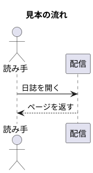

## 今日のまとめ

:::summary あなたが知っておくべきこと
- 見本の機能 A の設計がまとまりました
- 見本の不具合 B の原因が分かりました
- 明日は見本の機能 A の試験を書きます
:::

## 何が起きたか

朝、エージェントは見本の機能 A の設計を書き始めました。途中で、置き場の決め方に迷い、2つの案を比べました。

:::warning 気をつけること
本文に混ざった生のHTMLは、ページの中で動いてはいけません。

:::

```python title="sample.py"
print("</script><script>document.title='script-ran'</script>")
```

<!-- 日誌の中のコメントは、ページに出ません -->


